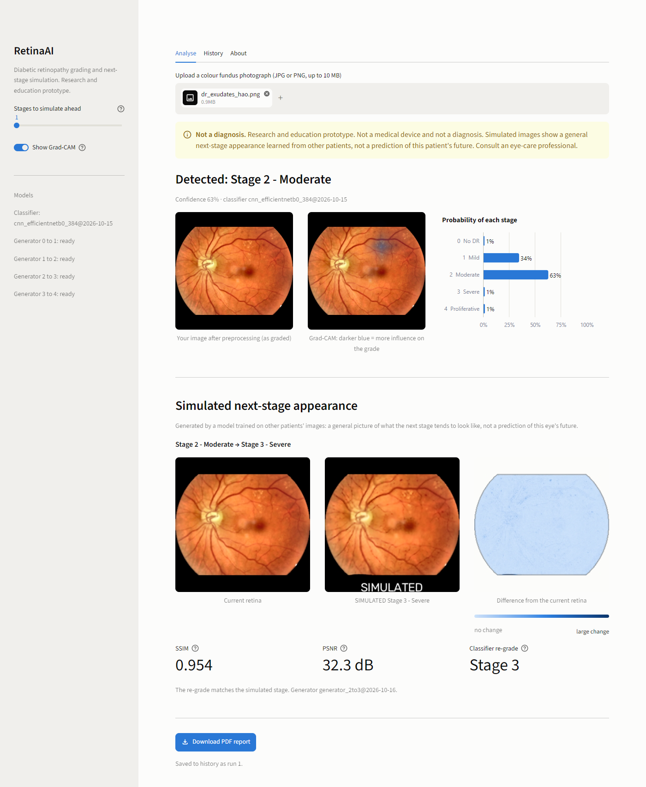
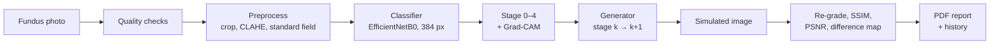
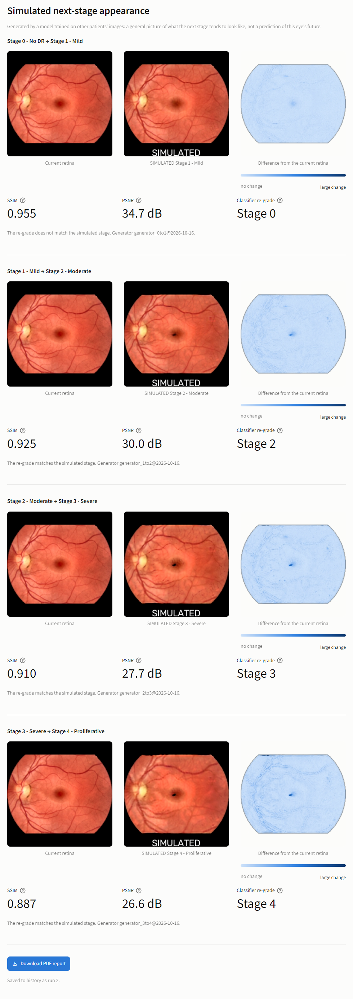
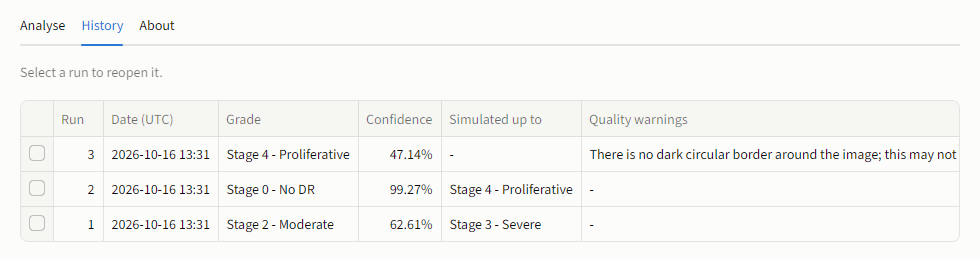

<div align="center">

# 👁️ RetinaAI

**Diabetic retinopathy grading and next-stage simulation from a single fundus photograph.**

Upload a retina photo. RetinaAI grades it from stage 0 to 4, shows where the model looked, and generates a
*simulated* image of how the retina could look at the next stage.


[Quick start](#-quick-start) •
[How to use](#-how-to-use) •
[Test images](#-test-images) •
[Results](#-results) •
[Datasets](#-datasets) •
[Training](docs/training.md)



<sub>Example input: <a href="https://commons.wikimedia.org/wiki/File:Fundus_-_diabetic_retinopathy.png">Hao et al.</a>, CC BY 4.0, via Wikimedia Commons.</sub>

</div>

> [!WARNING]
> **Not a medical device.** RetinaAI is a research and education prototype. Its grades are not a diagnosis, and
> the simulated images show a general next-stage appearance learned from *other* patients. They are not a
> prediction of any person's future. Always consult an eye-care professional.

## ✨ Features

| | |
|---|---|
| 🩺 **Stage grading** | EfficientNetB0 at 384 px grades five stages: 0 No DR, 1 Mild, 2 Moderate, 3 Severe, 4 Proliferative. Shows a probability for each stage. |
| 🔥 **Grad-CAM** | A heat map of the regions that most influenced the grade |
| 🧬 **Next-stage simulation** | One generator per transition (0→1, 1→2, 2→3, 3→4). Chain them to see every stage up to 4. |
| 📊 **Comparison** | Current and simulated retina side by side, with a difference map, SSIM, PSNR and the classifier's re-grade of the simulated image |
| ✅ **Quality checks** | Warns about blank, dark, blurry or non-fundus uploads before grading |
| 📄 **PDF report** | Downloads the whole analysis as a one-click report |
| 🗂️ **History** | Saves every run to a local SQLite database; reopen any past run |
| 💻 **Runs offline on a CPU** | About 1–2 s per analysis on a laptop. Images never leave your computer. |

## ⚙️ How it works



- **Preprocessing:** crops the black border, pads to a square, denoises, applies CLAHE contrast enhancement and masks to one standard field of view. Training and the app share the same code, so they can't drift apart.
- **Generators:** U-Net generators trained CycleGAN-style without paired photos, because there are no follow-up photos of the same eye. The frozen classifier guides them toward the target stage, and an anti-stamp loss stops them from pasting the same lesion into every image.

## 🚀 Quick start

**You need:** Python 3.12 (64-bit) and Git. No GPU. About 3 GB of free disk space for the packages. The trained
models (about 175 MB) come with the repository.

### 1. Clone

```bash
git clone https://github.com/RanjeetRG/RetinaAI.git
cd RetinaAI
```

### 2. Install and run

<details open>
<summary><b>Windows</b></summary>

```powershell
py -3.12 -m venv .venv
.venv\Scripts\python -m pip install -r requirements.txt
.\run_app.bat
```

After the first setup, start the app by double-clicking **`run_app.bat`**.

</details>

<details>
<summary><b>macOS / Linux</b></summary>

```bash
python3.12 -m venv .venv
source .venv/bin/activate
pip install -r requirements.txt
streamlit run app.py
```

</details>

### 3. Open the app

Your browser opens **http://localhost:8501**. If it doesn't, open that address yourself. Loading the models takes
a few seconds the first time.

> [!TIP]
> If port 8501 is busy, run `streamlit run app.py --server.port 8502` and open http://localhost:8502.

## 📖 How to use

1. **Upload a photo.** On the **Analyse** tab, drop in a colour fundus photograph (JPG or PNG, up to 10 MB). Need one? See [Test images](#-test-images).
2. **Read the grade.** You get the detected stage, the confidence, a probability for each stage, and the Grad-CAM map. Darker blue marks the regions that influenced the grade most.
3. **Look at the simulation.** Below the grade, the current retina is shown beside the **simulated** next stage, with:
   - a difference map (lighter means no change, darker means a large change)
   - SSIM and PSNR, which measure how similar the two images are
   - the classifier's re-grade of the simulated image
4. **Simulate further ahead.** In the sidebar, move **Stages to simulate ahead** up to 4 to chain the generators. Turn off **Show Grad-CAM** for a faster run.
5. **Download the report.** **Download PDF report** saves the whole analysis as a PDF.
6. **Revisit past runs.** The **History** tab lists every analysis; tick a row to reopen it and download its report again.

<details>
<summary><b>Example: a healthy retina simulated through all four stages</b></summary>
<br>

With **Stages to simulate ahead** set to 4, the generators are chained 0→1→2→3→4. The classifier re-grades each
simulated image.



<sub>Input: <a href="https://commons.wikimedia.org/wiki/File:Fundus_photograph_of_normal_left_eye.jpg">Mikael Häggström</a>, CC0, via Wikimedia Commons.</sub>
</details>

<details>
<summary><b>History tab</b></summary>
<br>

</details>

<details>
<summary><b>Command line (no browser)</b></summary>

```bash
python -m prediction.run path/to/fundus.jpg              # grade + simulate the next stage
python -m prediction.run path/to/fundus.jpg --steps 4    # chain the generators up to stage 4
python -m prediction.run path/to/fundus.jpg --no-save    # don't write the history or the PDF
```

Reports are saved in `reports/`, and the history database is `database/retinagen.db`.

</details>

## 🖼️ Test images

These photos are free to download and use. None of them is in the training data: each was checked with a
perceptual hash against all 38,788 dataset images. The **RetinaAI result** column shows what the app gave for
each one.

**How to test:** click **⬇ Download**, save the image (right-click → *Save image as…* if it opens in the browser),
and upload it on the **Analyse** tab.

| # | Image | Credit and license | RetinaAI result | |
|:-:|---|---|---|:-:|
| 1 | Healthy left eye | Mikael Häggström, CC0 | Stage 0 (99%) | [⬇ Download](https://upload.wikimedia.org/wikipedia/commons/4/48/Fundus_photograph_of_normal_left_eye.jpg) · [source](https://commons.wikimedia.org/wiki/File:Fundus_photograph_of_normal_left_eye.jpg) |
| 2 | Healthy right eye | Mikael Häggström, CC0 | Stage 0 (98%) | [⬇ Download](https://upload.wikimedia.org/wikipedia/commons/3/37/Fundus_photograph_of_normal_right_eye.jpg) · [source](https://commons.wikimedia.org/wiki/File:Fundus_photograph_of_normal_right_eye.jpg) |
| 3 | Healthy left eye, high resolution | Augenarztpraxis Dr. med. Stephan Kaut, CC0 | Stage 0 (94%) | [⬇ Download](https://upload.wikimedia.org/wikipedia/commons/4/4b/Fundus-photograph-left.jpg) · [source](https://commons.wikimedia.org/wiki/File:Fundus-photograph-left.jpg) |
| 4 | Healthy right eye | Jan Kaláb, CC BY-SA 2.0 | Stage 0 (86%) | [⬇ Download](https://upload.wikimedia.org/wikipedia/commons/c/cf/Right_eye_fundus_photograph.jpg) · [source](https://commons.wikimedia.org/wiki/File:Right_eye_fundus_photograph.jpg) |
| 5 | Normal retina | US National Eye Institute, public domain | Stage 0 (85%) ⚠️ | [⬇ Download](https://upload.wikimedia.org/wikipedia/commons/3/3d/Fundus_photograph-normal_retina_EDA06.JPG) · [source](https://commons.wikimedia.org/wiki/File:Fundus_photograph-normal_retina_EDA06.JPG) |
| 6 | DR with hard exudates and microaneurysms | Hao et al., CC BY 4.0 | Stage 2 (63%) | [⬇ Download](https://upload.wikimedia.org/wikipedia/commons/0/07/Fundus_-_diabetic_retinopathy.png) · [source](https://commons.wikimedia.org/wiki/File:Fundus_-_diabetic_retinopathy.png) |
| 7 | Background (non-proliferative) DR | US National Eye Institute, public domain | Stage 2 (38%) ⚠️ | [⬇ Download](https://upload.wikimedia.org/wikipedia/commons/c/cb/Fundus_retinopathy_EDA03.JPG) · [source](https://commons.wikimedia.org/wiki/File:Fundus_retinopathy_EDA03.JPG) |
| 8 | Diabetic macular edema | US National Eye Institute, public domain | Stage 2 (55%) ⚠️ | [⬇ Download](https://upload.wikimedia.org/wikipedia/commons/4/4b/Fundus_Diabetic_macular_edema_EDA04.JPG) · [source](https://commons.wikimedia.org/wiki/File:Fundus_Diabetic_macular_edema_EDA04.JPG) |
| 9 | Proliferative DR | US National Eye Institute, public domain | Stage 4 (47%) ⚠️ | [⬇ Download](https://upload.wikimedia.org/wikipedia/commons/9/9f/Fundus_Proliferative_retinopathy_EDA01.JPG) · [source](https://commons.wikimedia.org/wiki/File:Fundus_Proliferative_retinopathy_EDA01.JPG) |

⚠️ These photos are tightly cropped, so the app warns that there is *no dark circular border*. Grading still works.

### More test images

These graded datasets were **not** used to train RetinaAI, so they give a fair test:

| Dataset | Images | Grades | Get it |
|---|---|---|---|
| **IDRiD** (Indian Diabetic Retinopathy Image Dataset) | 516 for grading | DR 0–4 and macular edema 0–2 | [IEEE DataPort](https://ieee-dataport.org/node/956) (CC BY 4.0, free account) · [challenge page](https://idrid.grand-challenge.org/Data/) |
| **APTOS 2019, test set** (`test_images/`) | 1,928 | Not published | [Kaggle](https://www.kaggle.com/competitions/aptos2019-blindness-detection/data) (accept the competition rules) |
| **Messidor-2** | 1,748 | [Adjudicated grades from Google](https://www.kaggle.com/datasets/google-brain/messidor2-dr-grades) | [ADCIS license form](https://www.adcis.net/en/third-party/messidor2/) (research and education only) |

Use colour fundus photographs, not OCT scans, fluorescein angiograms or photos of the outside of the eye. Any
other image triggers the quality warnings, and its grade means nothing.

## 📈 Results

Measured on a held-out test set of **5,784 images**. It is split by patient, so no eye in it was seen during
training.

| Metric | RetinaAI (EfficientNetB0, 384 px) |
|---|---|
| Quadratic weighted kappa (QWK) | **0.745** (APTOS 0.890, EyePACS 0.708) |
| Accuracy | 80.2% |
| Referable DR (stage ≥ 2), ROC AUC | **0.916** |
| Screening cut-off (chosen on validation) | sensitivity 89.2%, specificity 73.7% |
| Speed, laptop CPU | median 1.3 s per grade + one simulation; 20/20 end-to-end runs without errors |

<details>
<summary><b>Comparison with other backbones</b> (same data and training recipe)</summary>

| Model | Input | QWK | Accuracy | Macro F1 | Referable AUC |
|---|---|---|---|---|---|
| **EfficientNetB0 (used by the app)** | **384 px** | **0.745** | **80.2%** | **0.539** | **0.916** |
| DenseNet121 | 224 px | 0.724 | 77.4% | 0.528 | 0.902 |
| ResNet50 | 224 px | 0.705 | 77.8% | 0.518 | 0.893 |
| MobileNetV2 | 224 px | 0.697 | 77.8% | 0.516 | 0.891 |
| EfficientNetB0 | 224 px | 0.676 | 76.2% | 0.496 | 0.883 |

Full tables, per-dataset results and confusion matrices are in [`outputs/eval/`](outputs/eval/paper_tables.md).
</details>

**Limitations**
- The simulated changes are subtle: mostly small dark lesion-like spots that grow as the generators are chained. See [docs/m4_limitations.md](docs/m4_limitations.md).
- Mild (stage 1) and severe (stage 3) DR are the hardest stages to tell apart. Accuracy is lower on EyePACS photos than on APTOS photos.
- The model has only been tested on APTOS and EyePACS images. Other cameras and populations may give different results.

## 📚 Datasets

The models were trained on public datasets. Dataset images are **not** included in this repository because their
licenses do not allow redistribution.

| Dataset | Role | Download |
|---|---|---|
| APTOS 2019 Blindness Detection | Training, validation, test | [Kaggle competition](https://www.kaggle.com/competitions/aptos2019-blindness-detection) |
| EyePACS (Kaggle DR, resized copy) | Training, validation, test | [Kaggle: diabetic-retinopathy-resized](https://www.kaggle.com/datasets/tanlikesmath/diabetic-retinopathy-resized) |
| Messidor-2 | External test (optional) | [ADCIS](https://www.adcis.net/en/third-party/messidor2/) + [grades on Kaggle](https://www.kaggle.com/datasets/google-brain/messidor2-dr-grades) |

After de-duplication and quality checks, **38,563** APTOS and EyePACS images were split 70/15/15 by patient. The
exact split is in [`dataset/manifests/splits.csv`](dataset/manifests/splits.csv). To download the data and retrain
everything, follow **[docs/training.md](docs/training.md)**.

## 🗂️ Project structure

```text
RetinaAI/
├── app.py                  Streamlit app (Analyse · History · About)
├── run_app.bat             Windows launcher
├── config.py               Paths, stage names, image sizes
├── models/                 Trained models: classifier + four transition generators
├── preprocessing/          Fundus crop, CLAHE, standard field, quality checks, dataset builder
├── cnn/                    Classifier: model, training, evaluation, metrics
├── gan/                    Transition generators: networks, CycleGAN training, FID/KID metrics
├── prediction/             End-to-end pipeline: grade → simulate → re-grade → compare
├── utils/                  SSIM/PSNR, Grad-CAM, charts, PDF report
├── database/               SQLite history
├── scripts/                Data download, GPU check, training launchers, end-to-end check
├── tests/                  pytest suite
├── outputs/eval/           Evaluation tables
├── docs/                   Training guide, data notes, generator limitations
└── PLAN.md                 Build log and design decisions
```

## 🧪 Tests

```bash
python -m pytest            # 81 fast tests (about 35 s)
python -m pytest -m slow    # the 4 slow tests, including a CNN training smoke test (a few minutes on CPU)
```

## 🛠️ Troubleshooting

| Problem | Fix |
|---|---|
| `py` or `python3.12` is not found | Install Python 3.12 from [python.org](https://www.python.org/downloads/). On Windows, tick *Add Python to PATH*. |
| `pip install` fails on TensorFlow | Use 64-bit Python 3.12, the version the pinned requirements are tested with. TensorFlow has no 32-bit builds. |
| "The stage … generator is not available yet" | The `models/` folder is incomplete. Clone the repository again, or download the ZIP from GitHub, which includes the models. |
| "There is no dark circular border…" | The photo is cropped tightly. The result is still shown, but use a full fundus photo when you can. |
| The app opens but nothing happens on upload | The first analysis loads the models. Wait a few seconds and keep the terminal open. |

## 🙏 Acknowledgements

- **Datasets:**
  - APTOS 2019 (Asia Pacific Tele-Ophthalmology Society)
  - EyePACS / Kaggle Diabetic Retinopathy Detection
  - Messidor-2 (LaTIM laboratory and the Messidor program partners), with grades from Krause et al., *Ophthalmology* 2018
  - IDRiD (Porwal et al., *Data* 3(3):25, 2018)
- **Test images:** the Wikimedia Commons contributors and the US National Eye Institute credited above.
- **Built with:** TensorFlow / Keras, Streamlit, OpenCV, scikit-image and fpdf2.

---

<div align="center">
<sub>RetinaAI is for research and education only. It is not a medical device and does not give a diagnosis.</sub>
</div>
